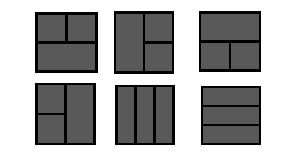

<!-- excerpt -->

## 문제

<https://www.acmicpc.net/problem/1451>

## 풀이



가능한 6가지 경우의 수를 생각하여 모든 경우의 수를 계산해주면 된다.

직사각형의 넓이를 구할때는 구간 합(prefix sum)을 이용하여 O(1)에 계산해줄 수 있다.

두 직사각형 사이에 한 직사각형이 껴있는 경우의 시간복잡도는 각각 O(N^2)과 O(M^2),

나머지 경우의 수는 시간복잡도가 O(NM)이므로, 대충 전체 시간복잡도는 O(NM).


## 소스

```c++
#include<iostream>
#include<algorithm>
using namespace std;

long long N, M, arr[111][111], sum[111][111], ans;

int main() {
	scanf("%d%d", &N, &M);
	for (int i = 1; i <= N; i++)
		for (int j = 1; j <= M; j++) {
			scanf("%1d", &arr[i][j]);
			sum[i][j] = sum[i - 1][j] + sum[i][j - 1] - sum[i - 1][j - 1] + arr[i][j];
		}
	for (int i = 1; i < N; i++)
		for (int j = 1; j < M; j++) {
			long long a, b, c;
			a = sum[i][j];
			b = sum[N][j] - sum[i][j];
			c = sum[N][M] - sum[N][j];
			ans = max(ans, a*b*c);

			b = sum[i][M] - sum[i][j];
			c = sum[N][M] - sum[i][M];
			ans = max(ans, a*b*c);

			a = sum[N][M] - sum[N][j] - sum[i][M] +sum[i][j];
			b = sum[N][j];
			c = sum[i][M] - sum[i][j];
			ans = max(ans, a*b*c);

			b = sum[i][M];
			c = sum[N][j] - sum[i][j];
			ans = max(ans, a*b*c);
		}
	for (int i = 1; i < N; i++)
		for (int j = i + 1; j < N; j++)
			ans = max(ans, sum[i][M] * (sum[j][M] - sum[i][M]) *(sum[N][M] - sum[j][M]));
	for (int i = 1; i < M; i++)
		for (int j = i + 1; j < M; j++)
			ans = max(ans, sum[N][i] * (sum[N][j] - sum[N][i]) *(sum[N][M] - sum[N][j]));
	cout << ans;
}
```

